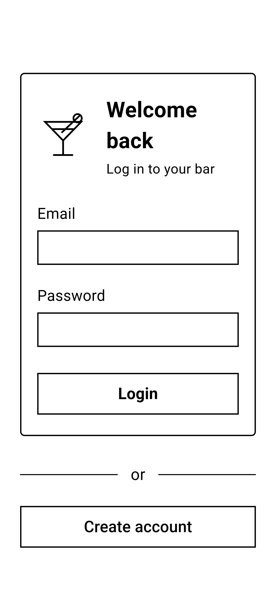
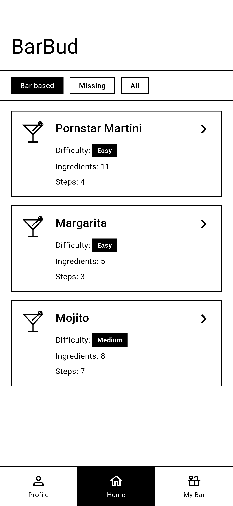
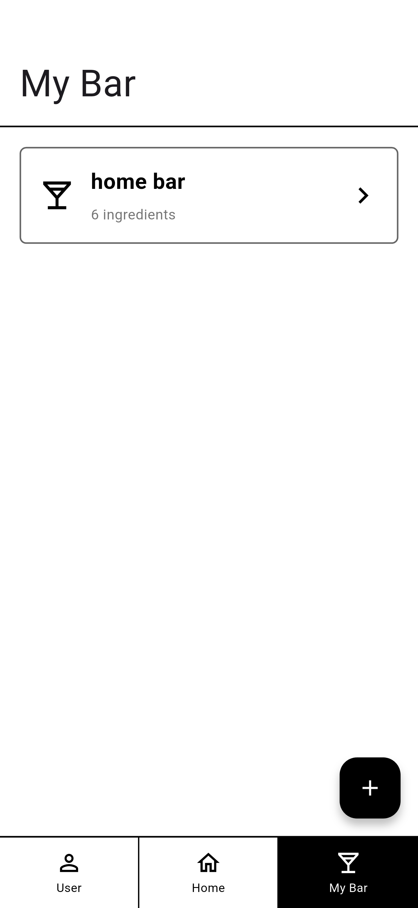
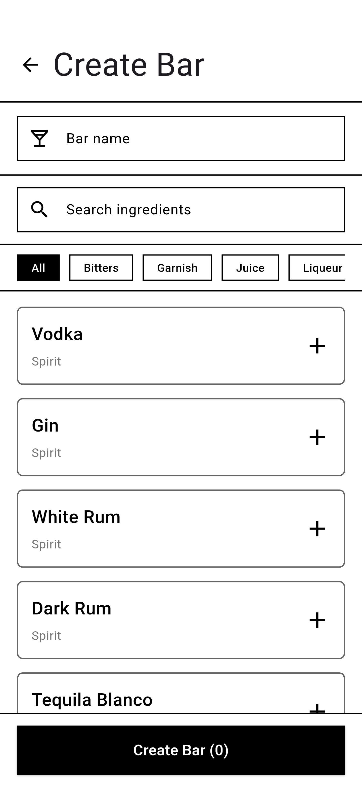
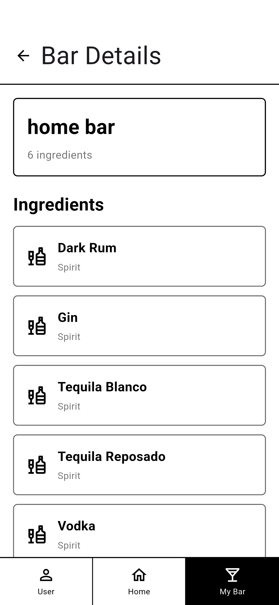

# BarBud

[Nederlands](#nederlands) | [English](#english)

---

## Nederlands

BarBud is een mobiele app die je helpt cocktails te maken met wat je thuis hebt staan. Je legt je eigen bar aan met de ingrediënten die je in huis hebt. Later gaat BarBud met behulp van AI drankjes voorstellen die je met die ingrediënten kunt maken.

Dit is een persoonlijk project. Ik heb het gebouwd voor het semester Full Stack Development bij Fontys Hogescholen en werk er nu verder aan om security by design toe te passen en de app veilig te maken.

Deze repository bevat de **Flutter-app**. De backend staat in [barbud-backend](https://github.com/WojtekZb/barbud-backend).

### Screenshots

| Inloggen | Home | Mijn bars |
|---|---|---|
|  |  |  |

| Bar aanmaken | Bardetails |
|---|---|
|  |  |

### Functionaliteiten

- Account aanmaken en inloggen
- Automatisch ingelogd blijven dankzij access- en refresh-tokens
- Tokens worden versleuteld op het toestel opgeslagen
- Meerdere bars aanmaken, bijvoorbeeld thuis of bij vrienden
- Per bar bijhouden welke ingrediënten je hebt

### Gepland

- AI die op basis van de ingrediënten in je bar drankjes voorstelt
- Een admin die eigen, originele drankjes kan toevoegen
- Security by design toepassen in de hele applicatie (in onderzoek)
- Een downloadpagina voor de app, zodra de backend veilig van buitenaf bereikbaar is

### Technologie

| Onderdeel | Technologie |
|---|---|
| Framework | Flutter (Dart) |
| API-communicatie | `http` |
| Opslag tokens | `flutter_secure_storage` |
| Testen | Widget-tests en end-to-end-tests met `integration_test` (robot pattern) |
| CI/CD | GitHub Actions bouwt bij elke push naar `main` een release-APK en zet die op de server |

### Projectstructuur

```
barbud_frontend/
├── lib/
│   ├── models/          Datamodellen (bar, bardetails, ingrediënt)
│   ├── pages/           Schermen: opstarten, inloggen, home, mijn bars, bar aanmaken, ingrediënten, bardetails
│   └── services/        Communicatie met de backend (authenticatie en bars)
└── integration_test/    End-to-end-tests met robots per scherm
```

---

## English

BarBud is a mobile app that helps you make cocktails with what you have at home. You set up your own bar with the ingredients you have. Later on, BarBud will use AI to suggest drinks you can make with those ingredients.

This is a personal project. I built it for the Full Stack Development semester at Fontys University of Applied Sciences and I'm now continuing to work on it to apply security by design and make the app secure.

This repository contains the **Flutter app**. The backend lives in [barbud-backend](https://github.com/WojtekZb/barbud-backend).

### Screenshots

| Login | Home | My bars |
|---|---|---|
|  |  |  |

| Create bar | Bar details |
|---|---|
|  |  |

### Features

- Create an account and log in
- Stay logged in automatically using access and refresh tokens
- Tokens are stored encrypted on the device
- Create multiple bars, for example at home or at a friend's place
- Keep track of which ingredients each bar has

### Planned

- AI that suggests drinks based on the ingredients in your bar
- An admin who can add their own original drinks
- Applying security by design across the whole application (being researched)
- A download page for the app, once the backend can be reached safely from outside

### Tech stack

| Part | Technology |
|---|---|
| Framework | Flutter (Dart) |
| API communication | `http` |
| Token storage | `flutter_secure_storage` |
| Testing | Widget tests and end-to-end tests with `integration_test` (robot pattern) |
| CI/CD | GitHub Actions builds a release APK on every push to `main` and uploads it to the server |

### Project structure

```
barbud_frontend/
├── lib/
│   ├── models/          Data models (bar, bar details, ingredient)
│   ├── pages/           Screens: startup, login, home, my bars, create bar, ingredients, bar details
│   └── services/        Communication with the backend (authentication and bars)
└── integration_test/    End-to-end tests with a robot per screen
```
